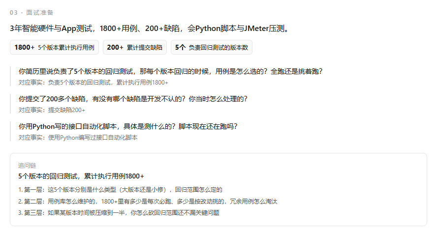

<p align="center">
  
</p>

<h1 align="center">OfferLab</h1>

<p align="center"><strong>给一个 JD，出一版能投的简历。</strong></p>

<p align="center">
  <a href="https://github.com/EMOGYifanWang/offeralb/actions/workflows/ci.yml"></a>
  
  
  <a href="https://offeralb.vercel.app"></a>
</p>

<p align="center">
  <a href="https://offeralb.vercel.app">在线演示</a> ·
  <a href="https://offeralb.vercel.app/demo">示例回放（不用登录）</a> ·
  <a href="https://offeralb.vercel.app/app/eval">评测结果</a>
</p>

---

以岗位为单位的求职工作台：**分析 → 定制 → 面试 → 投递**。

它和「让 ChatGPT 改简历」的区别只有一条：**模型不能创作，只能选材和改写**。每一条产出都要挂回简历原文，数字和技能由代码逐条比对，多一个就红框拦下。

## 它解决什么

- **改简历不知道改得对不对**：先算硬性要求覆盖率，缺口分「今天能补 / 一周能补 / 补不了」。
- **改完心里没底**：原文和改写逐条对照，改了什么、为什么改都写着。
- **面试被追问就露**：每条经历生成三层追问链，简历没证据的能力照样出题，但会标「简历无证据」。
- **投了记不住**：投递看板，状态流转 + 跟进提醒。

## 功能

| 模块 | 做什么 | 入口 |
|---|---|---|
| 竞争力分析 | 关键词覆盖 + 模型逐条判证据强弱、给补齐动作 | `/app` |
| 简历定制 | 选材、受约束改写、diff 对照、浏览器打印成 PDF | `/app/tailor` |
| 面试准备 | 技术/项目/行为/反问四类题库、追问链、两页速记卡 | `/app/prep` |
| 投递看板 | 状态流转、跟进日期、逾期高亮、按状态筛选 | `/app/jobs` |
| 采集与检索 | 书签一键收 JD，浏览器侧分词搜索公司/岗位/正文 | `/app/jobs` |
| 评测 | 可复现的指标，页面直接渲染 `eval/results.json` | `/app/eval` |
| 示例回放 | 真实模型输出固化，零 key 打开就能看 | `/demo` |

### 竞争力分析


### 简历定制


### 面试准备



## 三道闸

「熟练使用 Postman」写进简历只要一秒，面试官追问一句就露。所以防编造不靠模型自觉：

| 闸 | 规则 | 抓到过什么 |
|---|---|---|
| 数字闸 | 改写里每个数字必须在原文出现 | 模型把 JD 的「2 年经验」搬进简历 |
| 技能闸 | 改写里每个技能必须在原文出现（同义词也算） | 模型偷偷加了「多机型兼容性验证」 |
| 人工闸 | 逐条确认后才允许导出 | — |

闸门只能证明「没放过」，不能证明「没编」——这个区别写在 README 里，也写在页面上。

## 快速开始

```bash
git clone https://github.com/EMOGYifanWang/offeralb
cd offeralb
npm install
cp .env.example .env.local   # 填 DEEPSEEK_API_KEY
npm run dev
```

打开 http://localhost:3000 → `/demo` 看示例，或 `/app` 用自己的 JD。

不需要 Docker、数据库服务或任何外部账号。模型 key 只从服务端环境变量读取，不会发到浏览器。

### 配置模型（可选）

```bash
DEEPSEEK_API_KEY=sk-...
LLM_BASE_URL=https://api.deepseek.com/v1
LLM_MODEL=deepseek-chat
```

任何 OpenAI 兼容服务都能换。不配也能跑关键词分析，只是模型相关的功能会提示未配置。

## 评测

```bash
npm run eval        # 只跑确定性部分，不花钱
npm run eval:live   # 加上模型指标，需要 key
```

结果写进 `eval/results.json`，`/app/eval` 页面原样渲染这个文件。最近一次 live 跑：

| 指标 | 值 |
|---|---|
| 关键词精确率 / 召回率 | 100% / 100% |
| 覆盖率中位数 | 58.4% |
| 结构化输出合法率 | 100% |
| 单岗位耗时（分析+定制） | 5.8s |
| 编造拦截 | 0 处 |

> **这组数字要打折看**：评测集是自建的 6 条 JD，标注和技能词典同源，100% 的精确率有必然性。
> 它证明的是「行为一致、输出合法、耗时稳定」，不是「换个陌生 JD 也准」。

## 项目结构

```
app/
  page.tsx              官网落地页
  demo/                 示例回放（读 data/replay/*.json）
  app/                  应用：分析、定制、面试、投递、评测
  api/                  analyze / insight / tailor / prep
lib/
  analyze.ts            确定性关键词引擎（词典 + 分词 + 符号边界）
  skills.ts             80 条技能词典
  llm.ts                OpenAI 兼容调用、结构化 JSON、超时与错误
  insight.ts            Zod 校验 + 缺口过滤
  tailor.ts             数字闸与技能闸
  prep.ts               面试包校验与数字审计
prompts/                提示词，带版本号
eval/                   评测集与运行器
data/replay/            示例回放数据
public/shots/           产品截图
tests/                  44 个单测
```

## 技术栈

Next.js 15（App Router）+ TypeScript + Tailwind CSS v4 + Zod。
模型走 OpenAI 兼容协议，默认 DeepSeek。PDF 用浏览器打印，不引入任何 PDF 库。

## 数据与合规

- 示例 JD 自写，示例人物虚构，页面标注「示例数据」。
- **没有使用真实招聘网站数据**：Boss 直聘的 `robots.txt` 明确禁止查询类路径，也找不到同时满足「完整正文 + 明确许可 + 免登录」的中文公开数据集。
- 不做全站爬虫、不做自动投递。采集能力（书签脚本 + 本地检索）在路线图里，只做用户主动触发的单条抓取。

## 已知限制

- 投递看板存 localStorage，换浏览器或清缓存会丢。
- 检索在浏览器侧做，几百条内够快，上千条会明显变慢。
- 关键词引擎受词典覆盖限制，词典里没有的词提不出来。
- 评测集只有 6 条，且与词典同源，泛化能力未被验证。
- 移动端能用，但没做像素级适配。

## 路线图

- [ ] 事实库结构化：把简历拆成可复用的原子事实，而不只是一段文本
- [x] 书签采集器 + 本地分词检索
- [ ] 英文 README
- [ ] 暗色模式

## License

[MIT](LICENSE)
